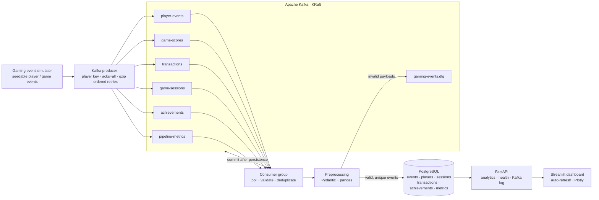
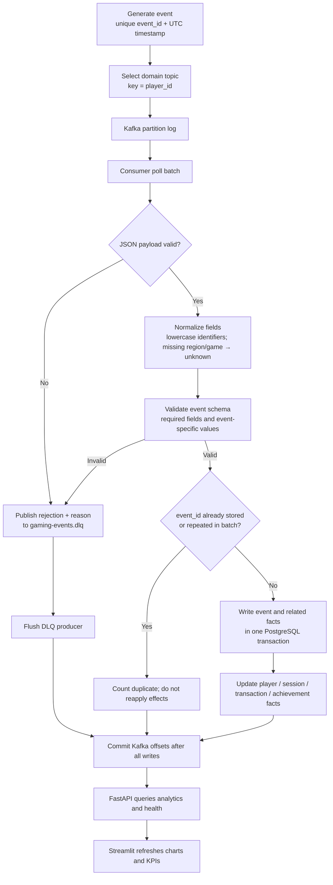
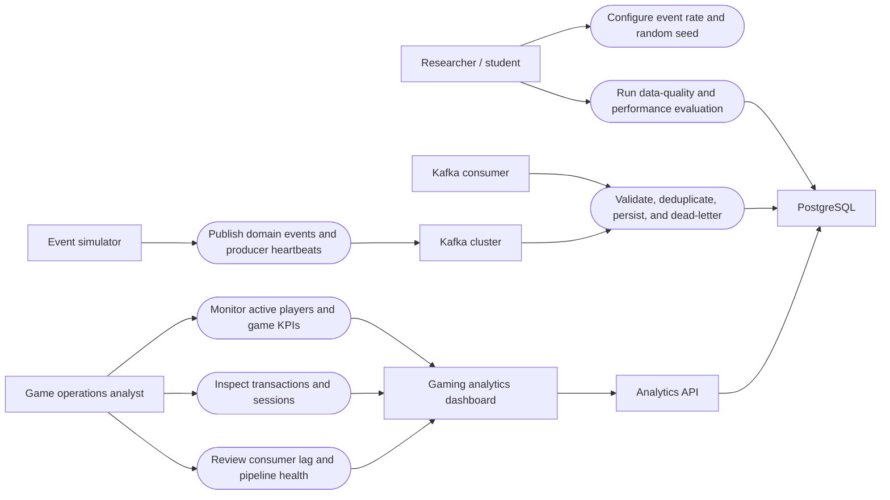
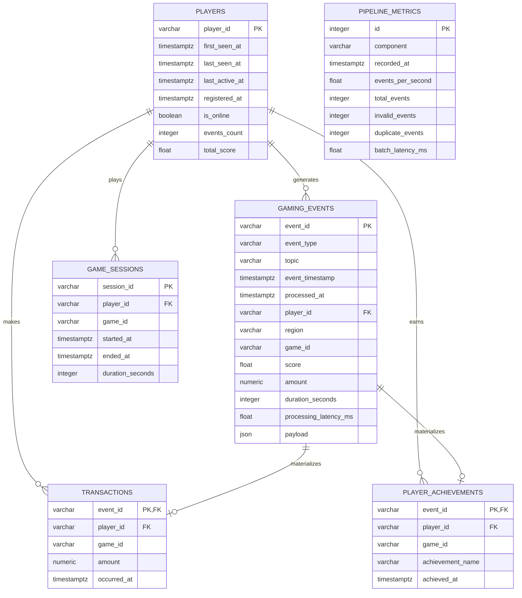

# Research Concept and System Architecture

## Research concept

The project is a reproducible streaming-data prototype for online-game operations. A synthetic game telemetry source continuously emits player, score, purchase, session, and achievement events. Kafka buffers those event streams by domain. A consumer validates and normalizes records, identifies duplicates, routes malformed records to a dead-letter topic, and commits Kafka offsets only after database work succeeds. PostgreSQL stores the event fact and related player, session, transaction, achievement, and pipeline-monitoring records. FastAPI serves database-backed analytics, while Streamlit polls those endpoints and renders a dark operational dashboard.

The experiment is designed to evaluate the behavior of this pipeline under controlled input rates. A single-node local deployment demonstrates integration; it is not evidence of production-scale throughput or broker fault tolerance.

## Architecture diagram

## Data-flow diagram

## Use-case diagram

## Relational entity-relationship diagram

## Kafka topic and event contract

All game events contain a unique `event_id`, a timezone-aware ISO-8601 `timestamp`, a supported `type`, and a non-empty `user_id`. `region` and `game_id` are normalized to lowercase and use `unknown` when absent. If an event arrives without an ID, the preprocessor derives a stable SHA-256 ID from its canonical JSON representation; byte-for-byte equivalent payloads therefore deduplicate. A missing player ID, timestamp, required score, purchase amount, or achievement name is rejected rather than silently fabricated.

| Topic | Event types | Key | Purpose |
|---|---|---|---|
| `player-events` | registration, login, logout, error, matchmaking request/result | `user_id` | Player lifecycle and operational events |
| `game-scores` | score | `user_id` | Score facts and leaderboard updates |
| `transactions` | purchase | `user_id` | Economy records |
| `game-sessions` | session start/end | `user_id` | Session facts and duration |
| `achievements` | achievement | `user_id` | Achievement facts |
| `pipeline-metrics` | producer heartbeat | component name | Producer throughput monitoring |
| `gaming-events.dlq` | rejected message envelope | fixed rejection key | Invalid JSON, schema, or routing records |

Kafka ordering is per partition, not global. Using a player key preserves ordering for one player within a topic. Events spanning different topics do not have a total order. The consumer uses manual offset commits: domain records are committed after PostgreSQL writes and dead-letter publishing complete. The event ID primary key makes redelivery idempotent and provides at-least-once delivery with deduplicated database effects; this is not a claim of end-to-end exactly-once processing.

The producer uses `acks=all`, gzip compression, and one in-flight request per broker connection so retries do not reorder its sends. Producer heartbeat totals count broker-acknowledged game events rather than queued sends.

## Methodology and evaluation protocol

1. **Generate:** emit seeded, timestamped player lifecycle, score, purchase, achievement, matchmaking, and session events at a configured rate.
2. **Collect:** route events to domain topics and partition by player ID. The local Compose broker has one node and three default partitions per topic.
3. **Preprocess:** decode JSON, canonicalize identifiers, impute only documented categorical fields, validate required and type-specific values, and remove duplicate IDs.
4. **Reject:** publish malformed or schema-invalid messages to the DLQ with the original payload and rejection reason. No invalid event is represented as a successful game fact.
5. **Persist:** write an event and its normalized side-table facts in one PostgreSQL transaction. Commit Kafka offsets only after processing has completed.
6. **Analyze:** compute KPIs and trends from stored facts using SQL, pandas, and NumPy.
7. **Visualize:** poll the HTTP API from Streamlit at a configurable refresh interval; the dashboard never consumes Kafka directly.
8. **Evaluate:** run unit and integration tests; for a distributed experiment, record machine/VM details, event count, producer target rate, partition count, consumer count, warm-up, repeated trial count, and measured latency/throughput. Report run-level median and p95 rather than treating a configured target as measured throughput.

The Compose setup is a teaching deployment: one Kafka broker and one PostgreSQL instance have no high availability. To study scale, increase Kafka brokers and partitions, run multiple consumer replicas in the same group, and record partition assignment, consumer lag, CPU, memory, and database saturation. A local single-broker result must not be extrapolated to a production cluster.
